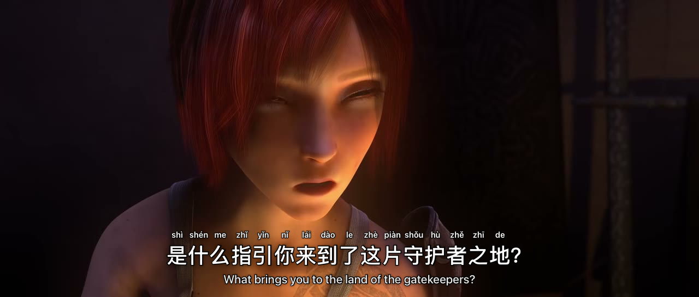
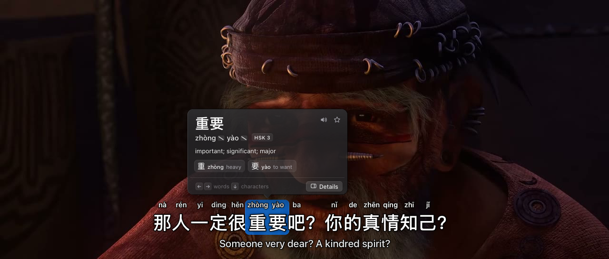
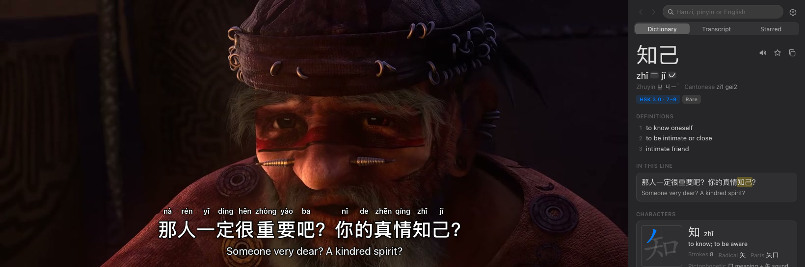

# Hanzi Lens for IINA

Interactive Chinese subtitles for [IINA](https://iina.io), the macOS video player.

- **Pinyin over every character**, with tone marks and optional tone-contour shapes (readable without relying on colour). Zhuyin, or **Jyutping** for Cantonese, instead if you prefer: Jyutping is read in context with CanCLID's [to-jyutping](https://github.com/CanCLID/to-jyutping), so 係咪, 喺度 and 會 get the right readings, and written-Cantonese words work too.
- **Click any word** for a dictionary card: readings, definitions, HSK level and the characters inside it. Playback pauses while the card is open. Arrow keys move between words.
- **English line under the Chinese.** If the file has an English subtitle track it is used as-is; otherwise the line is translated on the Mac with Apple's Translation framework.
- **Sidebar dictionary**: full entries with stroke order, components, example sentences, a transcript that seeks the video, and starred words you can export as a flashcard file.
- Everything runs locally. The dictionary is bundled; no account and no server.

| Subtitle line | Word card | Sidebar entry |
| --- | --- | --- |
|  |  |  |

The pictures show *Sintel* (© Blender Foundation, [CC BY 3.0](https://creativecommons.org/licenses/by/3.0/)) with its official Chinese and English subtitles. They are rendered by the plugin's own overlay and sidebar code in WebKit (the engine IINA uses) through the harness in `dev/`, not captured from a live IINA window.

## Install

In IINA, open Settings → Plugins, choose to install from GitHub and enter:

    zollans/hanzi-lens-iina

IINA downloads the packaged plugin from the latest release and can check for updates later. Then open a video with a Chinese text subtitle track. Settings are in the sidebar's gear button and in Settings → Plugins → Hanzi Lens.

Requires an IINA version with plugin support (developed on IINA 1.5). On-device translation uses Apple's Translation framework, which needs macOS 15 or later; without it you still get pinyin, lookup and the English track. The bundled translation helper is built for Apple silicon.

### For development

Clone the repository and link it into IINA's plugin folder, then quit and reopen IINA:

    ln -s "$PWD" ~/Library/Application\ Support/com.colliderli.iina/plugins/hanzi-lens.iinaplugin-dev

`tools/package.sh` builds the `.iinaplgz` that releases ship.

## Layout

- `main.js` — plugin entry: subtitle polling, track selection, translation, menu, preferences
- `ui/overlay.*` — the on-video subtitle line and word card
- `ui/sidebar.*` — dictionary, transcript and starred words
- `ui/lib/` — dictionary lookup, segmentation, pinyin, stroke animation
- `ui/data/`, `ui/strokes/` — generated dictionary data (see below)
- `tools/build_dict.py` — rebuilds the data from the upstream sources
- `tools/hl-translate.swift`, `bin/hl-translate` — small helper for Apple's Translation framework
- `dev/` — browser harness and a WebKit snapshot tool for working on the UI without IINA

## Licences

The plugin's own code is under the MIT licence (`LICENSE`). The bundled dictionary data comes from other projects under their own licences; see [THIRD_PARTY.md](THIRD_PARTY.md).

Hanzi Lens is an independent project and is not affiliated with IINA.
